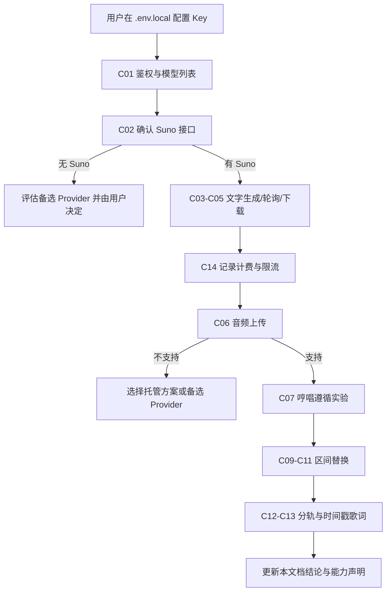

# 音乐 API 能力验证计划

> 文档版本：v0.1（第一阶段规划稿）
> 更新日期：2026-10-20
> 状态：已完成 FluxPort 第一轮能力验证与 5 分钟歌曲实测。FluxPort 结论以第 11 节为准；前文保留验证方法。另已按用户要求接入 suno-api.io 实验功能，见第 12 节。

## 1. 目的与原则

本项目的两个核心需求（哼唱成曲、局部旋律替换）是否可以"真实实现"，完全取决于所用音乐模型的能力。本文档：

1. 记录目前已核实的事实，并与"尚未核实的推测"严格区分。
2. 列出需要验证的每一项能力、验证方法、通过标准和失败后的备选方案。
3. 对两个哼唱需求给出多条技术路线的对比与推荐。

原则：

- 没有实测证据的能力，一律视为"未验证"，不能写进代码的能力声明，也不能在界面上宣称支持。
- 其他平台的文档只能证明"这类能力在行业内存在"，**不能**证明 FluxPort 支持。
- 每项结论都要有证据文件（脱敏后的请求、响应、生成音频和听感记录）。

## 2. 已核实的事实（2026-10-20）

核实方式：公开网页检索；对 `uselg.top` 与 `api.uselg.top` 发起不带 Key 的只读请求，观察返回码。

| 事实 | 依据 |
| --- | --- |
| FluxPort 的站点为 `https://uselg.top`，页面标题 "FluxPort - AI API Gateway"，副标题 "Subscription to API Conversion Platform" | 首页 HTML 与公开配置 |
| 服务条款将其描述为"AI 模型 API 调用管理与中转平台"，提供统一接入地址和 OpenAI 兼容接口 | 公开配置中的服务条款文本 |
| API 地址为 `https://api.uselg.top/v1` | 公开配置 `api_base_url` |
| 文档地址为 `https://uselg.top/docs`，为前端渲染页面，匿名抓取未能读取内容 | 公开配置 `doc_url` 与抓取结果 |
| 另有"图片/视频直连接口" `https://api.ai-media.vip/v1`，官方说明用于图片、视频长耗时请求 | 公开配置 `custom_endpoints` |
| `POST https://api.uselg.top/v1/chat/completions` 不带 Key 返回 401，错误码 `API_KEY_REQUIRED`，提示可用 `Authorization: Bearer`、`x-api-key` 或 `x-goog-api-key` 传 Key | 实际请求 |
| `POST https://api.uselg.top/v1/suno/submit/music` 返回 404；`/suno/submit/music`、`/suno/fetch` 返回的是前端页面 HTML，而非 API 响应 | 实际请求 |

**结论（匿名阶段）**：没有公开证据表明 FluxPort 提供 Suno 音乐接口，需持 Key 验证。

**持 Key 验证后的更新**：Key 可用；账号可用模型为 `suno`、`Lyria-3.5音频音乐`、`Lyria-3pro音频音乐`；`suno` 可通过 OpenAI 兼容的 `/v1/chat/completions` 同步生成歌曲。详见第 11 节结论表。

## 3. 行业参考（非 FluxPort，仅供设计参考）

以下信息来自其他第三方 Suno 网关的公开文档，均为非官方接口，不代表 FluxPort 的能力，也可能随时变化。

| 来源 | 公开文档中出现的能力 | 与本项目的关系 |
| --- | --- | --- |
| FluxProxy（fluxproxy.org，与 FluxPort 不是同一平台） | 仅 `POST /suno/submit/music` + `POST /suno/fetch` 文字生成与歌词生成，一次返回两首候选，建议轮询间隔 15 秒以上 | 说明部分网关只开放文字生成 |
| MountSea Suno 接口文档 | `upload_cover`、`upload_extend`、`replace_section`；`replace_section` 需要 `clip_id`、`range`（文档写区间应大于 6 秒）、`infill_context_range`（建议前后各约 30 秒）、`infill_lyrics`，`infill_type` 可选 `smart` / `classic` / `fixed`；`controls` 中有 `audio_weight`、`style_weight` | 说明 Suno 存在原生区间替换，但其条件是歌词与风格，文档中未见以音频作为区间替换条件 |
| sunoapi.org | Upload And Cover、Upload And Extend；生成接口的非自定义模式可传 `audioUrls`；自定义模式有 `audioWeight`；生成文件保留 14 天 | 说明上传音频多以公网 URL 方式提供，结果有保留期限 |
| suno-api.io | 文档列出 cover、Extend、stems、声音克隆等 | 说明分轨能力在部分网关可用 |

由此得到的设计假设（**均需验证**）：

1. 哼唱成曲最接近的现有能力是"上传音频 + cover"。
2. 原生区间替换可能存在，但可能**不接受哼唱作为条件**。
3. 上传音频可能需要公网 URL。
4. 生成结果的 URL 有有效期。

## 4. 需求与能力的对应关系

| 需求 | 必需能力 | 增强能力 |
| --- | --- | --- |
| 文字创作歌曲（FR-GEN） | C01、C02、C03、C04、C05 | C13、C14 |
| 哼唱成曲（FR-HUM-05） | C06、C07 | C08 |
| 局部旋律替换（FR-EDIT-05） | 原生路线：C09 + C11；降级路线：C06 + C07 | C10、C12、C13 |
| 成本与可靠性（FR-JOB） | C04、C14 | - |

## 5. 验证清单

每项验证都要在 `docs/api-evidence/<编号>-<日期>/` 下保存：脱敏的请求、响应、生成音频（如有）和 `notes.md`（结论、听感、费用）。

| 编号 | 能力 | 验证方法 | 通过标准 | 失败时的备选 |
| --- | --- | --- | --- | --- |
| C01 | 鉴权与模型列表 | 用 Key 调用 `GET /v1/models`；查找与 suno / music / audio 相关的模型 ID | 返回 200，能列出可用模型 | Key 无效则联系平台；无音乐模型则进入 C02 确认是否有独立接口 |
| C02 | Suno 接口路径与协议 | 登录后阅读 `/docs`；必要时咨询平台客服；同时确认 `api.ai-media.vip/v1` 是否承载音频任务 | 获得明确的提交与查询接口、参数说明 | 若 FluxPort 不提供 Suno：评估备选 Provider（见第 8 节），由用户决定 |
| C03 | 文字生成歌曲 | 分别提交：自定义歌词 + 风格；仅描述；纯音乐。记录模型版本参数、候选数量、时长、音频格式 | 结果可播放，歌词基本按输入演唱，风格与描述大体一致 | 若只支持描述模式：歌词输入作为提示的一部分，界面注明"歌词不保证逐字演唱" |
| C04 | 任务提交与轮询 | 记录状态值序列、完成耗时、错误响应结构、建议轮询间隔、超时情况 | 状态值完整、可稳定查询到结果 | 若只能同步等待：worker 中设置长超时并做好崩溃恢复 |
| C05 | 结果下载与格式 | 下载结果；24 小时、72 小时后再次访问 URL；确认是否可取 WAV | 下载成功；记录 URL 有效期 | 无 WAV 时保存原格式，内部处理统一转 WAV，避免反复有损编码 |
| C06 | 音频上传 | 确认上传方式（multipart / base64 / 公网 URL）、大小与时长上限、支持格式、是否有版权检测 | 能上传 30 秒哼唱并得到可引用的音频标识 | 只支持公网 URL 时按 ARCHITECTURE 第 8 节选择托管方案；完全不支持上传则 C07、C08 判定为不支持 |
| C07 | 上传哼唱 + cover 是否遵循旋律 | 见 5.1 的实验设计 | 达到 5.1 的判定标准 | 按第 6 节降级路线 |
| C08 | 上传哼唱 + extend | 上传哼唱，从哼唱末尾续写，观察续写部分是否沿用哼唱的动机 | 续写自然，结果包含或延续哼唱旋律 | 不作为哼唱成曲主路线，仅作补充 |
| C09 | 原生区间替换 | 分别对"由 API 生成的歌曲"和"上传的歌曲"执行区间替换；测试 5 秒、10 秒、30 秒等不同区间长度；记录返回的是整曲还是片段 | 至少对 API 生成的歌曲可用，并得到最短区间等限制 | 按第 7 节降级路线 |
| C10 | 未修改区域保真度 | 将返回的整曲与原曲做互相关对齐，计算区间外的残差能量 | 记录残差水平（无论是否通过，都采用本地重建原则） | 本地重建可保证区间外与原曲一致 |
| C11 | 区间替换是否接受音频条件 | 在 C09 的请求中尝试传入哼唱音频；对照组不传音频 | 有音频与无音频的结果在区间内旋律上有明显且一致的差异，且接近哼唱 | 判定为不支持，局部替换使用降级路线 |
| C12 | 分轨 | 对生成曲请求人声/伴奏分离 | 得到可用的分轨音频 | 后期考虑本地 Demucs |
| C13 | 带时间戳歌词 | 查询生成曲的歌词时间信息 | 得到逐句或逐词时间 | 用户手动框选区间，不依赖歌词时间 |
| C14 | 限流、并发、计费 | 记录每类调用的扣费、失败是否扣费、并发上限、限流错误码 | 获得可用于成本提示的数据 | 界面显示"费用未知"，并默认串行执行 |

### 5.1 C07 实验设计：如何判断"真的按哼唱生成"

这是避免"把文字生成冒充哼唱生成"的关键实验。

**测试素材**（均由用户自己录制，避免版权问题）：

- H1：一段 15-30 秒、旋律清晰的哼唱（例如上行再下行的简单乐句）。
- H2：与 H1 节奏相近、但旋律走向明显不同的哼唱。
- H3：一段音高不稳、带环境噪声的真实哼唱。

**实验组与对照组**：

| 组别 | 输入 |
| --- | --- |
| 实验组 A | H1 + 歌词 + 风格 |
| 实验组 B | H2 + 相同歌词 + 相同风格 |
| 对照组 | 不提供音频，仅相同歌词 + 相同风格 |
| 增强组 | H1 经本地转 MIDI 后合成的干净引导旋律 + 相同歌词与风格 |

**判定方法**：

1. 人工试听：A 与 B 的旋律是否明显不同，且分别能听出 H1、H2 的走势；对照组是否与二者都不同。每组至少生成 2 次。
2. 客观参考：用 pYIN 提取哼唱与生成结果（如有分轨则用人声轨）的音高曲线，转换为相对半音并去除调性偏移，计算 DTW 距离。比较"A 对 H1"与"A 对 H2"、"对照组对 H1"的距离。
3. 判定为"支持哼唱条件"需同时满足：A、B 的结果分别更接近各自的哼唱；对照组明显更远；人工试听至少一半的结果能辨认出原哼唱。
4. 若只有增强组满足条件，则结论为"支持，但需要本地预处理"。

**预算**：C07 预计 8-12 次生成调用，具体费用在 C14 获得单价后估算，执行前先向用户确认。

## 6. 哼唱成曲的路线对比

| 路线 | 做法 | 优点 | 缺点 | 前置条件 |
| --- | --- | --- | --- | --- |
| A. Provider 上传 + cover | 上传哼唱，以 cover 方式按歌词和风格重新演绎 | 一步得到带人声和伴奏的完整歌曲；工程量小 | 旋律遵循度不可控；可能受版权检测、上传方式限制 | C06、C07 |
| B. Provider 上传 + extend | 以哼唱为开头续写整首歌 | 哼唱的动机可能延续到后续段落 | 结果开头包含原始哼唱，需要裁剪；后续旋律不一定遵循哼唱 | C06、C08 |
| C. 本地旋律提取 + 引导旋律 | 本地用 pYIN 或 basic-pitch 提取音高并量化为 MIDI，合成干净的引导旋律，再作为路线 A 的输入 | 去除噪声和跑调，提高模型"听懂"旋律的概率；用户可预览和修正音符 | 多一步处理；量化可能改变用户原意；依然依赖路线 A | C06、C07 |
| D. 开源旋律条件模型 | 例如 MusicGen-melody（以旋律色度为条件，只生成纯音乐）或 ACE-Step 等开源歌曲模型 | 不依赖第三方网关；可控性更强 | 需要评估本机算力与生成质量；MusicGen-melody 不生成人声；开源模型的哼唱条件能力同样需要验证 | 本机硬件评估 |
| E. 纯文字生成 | 只用歌词和风格描述 | 一定可用 | **不是**哼唱条件生成，不能作为该需求的实现 | 无 |

**推荐**：

1. 主路线：A，必要时叠加 C（先验证 A，若遵循度不足再测 C）。
2. 若 FluxPort 不支持上传或 cover：在用户同意的前提下评估提供该能力的备选 Provider（第 8 节）。
3. D 作为长期备选，仅在网关路线都不可用时投入评估。
4. E 只能作为"文字创作"功能存在，界面上不得以哼唱名义出现。

## 7. 局部旋律替换的路线对比

| 路线 | 做法 | 优点 | 缺点 | 前置条件 |
| --- | --- | --- | --- | --- |
| 1. 原生区间替换（文字条件） | 调用模型的区间替换，以新歌词和风格为条件 | 衔接由模型处理，音色与原曲一致性最好 | 很可能**不能用哼唱**作为条件；上传歌曲可能不支持；区间有最短限制 | C09 |
| 1+. 原生区间替换（音频条件） | 同上，并传入哼唱 | 最接近目标需求 | 目前没有任何公开证据表明存在 | C09、C11 |
| 2. 哼唱生成片段 + 本地拼接 | 用路线 A 以哼唱生成一段新音乐（风格提示尽量贴近原曲），本地检测速度与调性，对齐节拍后替换原曲区间并交叉淡化 | 不依赖原生区间替换；哼唱条件真实有效（若 C07 通过） | 新片段的人声音色、编曲可能与原曲不一致，衔接质量取决于本地处理 | C06、C07；本地音频服务 |
| 3. 分轨后只替换人声 | 将原曲分离为人声与伴奏，只替换区间内的人声，再与原伴奏混合 | 保留原伴奏，衔接更自然 | 新人声需与原伴奏和声匹配，难度高；分轨有损 | C12 或本地 Demucs，以及路线 2 |
| 4. 开源 repaint 模型 | 使用支持区间重绘的开源歌曲模型 | 可控、离线 | 需算力评估；哼唱条件能力需验证 | 本机硬件评估 |

**推荐**：

1. 先实现与能力无关的**本地拼接引擎**（裁剪、节拍检测、对齐、交叉淡化、空测试），它是所有路线的最后一步。
2. C11 通过：采用路线 1+，界面标注"API 原生 + 本地重建"。
3. 只有 C09 通过：提供路线 1，界面明确写"本次修改未使用哼唱旋律，仅按歌词与要求重写"，同时提供路线 2 作为"按哼唱重写"的选项，并标注为降级方案。
4. C09 不通过但 C07 通过：采用路线 2，标注为降级方案，说明音色可能与原曲不一致。
5. 都不通过：局部替换功能只保留"本地剪辑与拼接"（例如用其他版本的片段替换），不提供 AI 重写，并如实说明。

**能力边界的诚实表述**：在任何路线下，"只修改指定区域"由本地重建保证；"新片段与原曲自然衔接"是尽力而为，需要靠 A/B 试听确认，系统不承诺一定无缝。

## 8. 备选 Provider

用户已同意在 FluxPort 能力不足时评估其他 Provider。原则：

- 新 Provider 只通过 `MusicProvider` 接口接入，不改动业务层。
- 接入前同样执行 C01-C14 验证，不因其文档声称支持就直接采用。
- 评估维度：所需能力是否齐全、上传方式、价格、稳定性、条款与数据处理方式、结果保留期限。
- 第三方 Suno 网关均为非官方接口，存在服务中断与条款风险，需在文档中注明。

## 9. 验证执行流程

- 验证脚本放在 `scripts/` 下，只从环境变量读取 Key，输出自动脱敏。
- 每一步涉及付费调用前，先告知用户预计调用次数。
- 验证用的歌曲优先使用 API 自己生成的歌曲和用户自录的哼唱，避免版权问题。

## 10. 主要风险

| 风险 | 影响 | 应对 |
| --- | --- | --- |
| FluxPort 不提供 Suno 或音乐接口 | 所有远程生成功能受阻 | C02 尽早确认；准备备选 Provider |
| 只支持公网 URL 上传 | 需要临时暴露本地文件，有隐私风险 | 用户显式开启、短时有效；或改用支持直接上传的 Provider |
| 原生区间替换不接受哼唱条件 | "按哼唱局部替换"无法原生实现 | 路线 2 降级，并如实标注 |
| 上传音频受版权检测 | 导入的商业歌曲无法做远程处理 | 提示用户；本地功能不受影响 |
| 结果 URL 过期 | 历史结果丢失 | 任务成功后立即下载 |
| 第三方网关不稳定或条款变化 | 功能突然不可用 | Provider 隔离；任务失败可重试；保留本地结果 |
| 生成费用累积 | 成本不可控 | 显示调用次数与费用；默认串行；验证前先确认预算 |

## 11. 验证结论记录

| 编号 | 结论 | 验证日期 | 证据路径 | 备注 |
| --- | --- | --- | --- | --- |
| C01 | 通过 | 2026-10-20 | `docs/api-evidence/C01-C02-2026-10-20/result.json` | `GET /v1/models` 返回 200，共 3 个模型：`suno`、`Lyria-3.5音频音乐`、`Lyria-3pro音频音乐`，`owned_by` 均为 `fluxport`；`api.ai-media.vip/v1/models` 返回相同列表 |
| C02 | 通过 | 2026-10-20 | `docs/api-evidence/C02-chat-suno-2026-10-20/`、`docs/api-evidence/fluxport-docs-2026-10-20/` | 官方文档与实测一致：Suno 与 Lyria 都只走 `POST /v1/chat/completions`，`stream: false`，内容写在 `messages[].content`（Lyria 最多 10000 字符）；Suno 的 `n` 只能为 1。没有独立的歌词、纯音乐、时长、负面提示词字段 |
| C03 | 部分通过 | 2026-10-20 | 同上 | 仅测试了一句英文描述（要求 30 秒、原声吉他、女声）。返回 2 首候选，时长 27.9 秒与 29.1 秒。官方文档说明歌词、人声、器乐要求只能写在文字里，**不保证精确执行**。中文歌词逐字演唱效果尚未测试 |
| C04 | 通过（同步模式） | 2026-10-20 | 同上 | 同步接口，无任务 ID、无查询与回调接口，本次耗时 54.4 秒。官方建议客户端等待上限 600 秒（Lyria 660 秒），**禁止自动重试**，且不支持 `Idempotency-Key` 去重。结果链接在 `choices[].message.content`（Lyria 还可能在 `data[].url` / `download_url` / `audio_url`）。`usage` 不反映费用。**影响**：worker 关闭自动重试；请求中断即标记 `unknown_submission`，由用户核对使用记录 |
| C05 | 部分通过 | 2026-10-20 | 同上 | 音频为 mp3、48 kHz、立体声、约 185 kbps，托管在第三方域名，URL 带 `expires` 与 `signature`，有效期约 1 小时（`expires - created` 约 3650 秒）。下载较慢（约 650 KB 用时约 1 分钟）。WAV 未测试。**影响**：必须在拿到结果后立即下载 |
| C06 | FluxPort 不支持 | 2026-10-20 | `docs/api-evidence/fluxport-docs-2026-10-20/suno.md` | Suno 文档原文："当前不支持参考音频、音频上传、续写"。Lyria 文档："参考图片、参考音频、上传、续写……尚未提供可用性保证" |
| C07 | FluxPort 不支持 | 2026-10-20 | 同上 | 无音频输入，因此无法以哼唱为条件生成 |
| C08 | FluxPort 不支持 | 2026-10-20 | 同上 | 文档明确不支持续写 |
| C09 | FluxPort 不支持 | 2026-10-20 | 同上 | 文档未提供区间替换；无 clip ID、无任务查询，无法引用已有歌曲 |
| C10 | 不适用 | 2026-10-20 | - | 依赖 C09 |
| C11 | FluxPort 不支持 | 2026-10-20 | 同上 | 依赖 C06 与 C09 |
| C12 | FluxPort 不支持 | 2026-10-20 | 同上 | 文档未提供分轨 |
| C13 | FluxPort 不支持 | 2026-10-20 | 同上 | 文档未提供带时间戳歌词 |
| C14 | 部分通过 | 2026-10-20 | 用户控制台核对 + 官方文档 + 用户提供的模型说明截图 | 用户确认 `suno` 与两款 Lyria 每次调用均为固定 0.2 元。官方文档：成功请求按固定单价计费，不按秒数、Token 或返回曲数加价；重复 POST 视为新请求、可能再次收费。模型说明：Suno 每次返回 2 条音频；`Lyria-3.5音频音乐` 单曲最长约 5 分钟，`Lyria-3pro音频音乐` 单曲最长约 3 分钟，提示词均最多 10000 字符。尚未确认：失败是否扣费、并发与限流上限 |
| C15 | Suno 通过；Lyria 3.5 未达标 | 2026-10-20 | `docs/api-evidence/C15-suno-2026-10-20/`、`docs/api-evidence/C15-Lyria-3.5_-2026-10-20/`；提示词 `scripts/prompts/c15-five-minute-zh.txt` | 同一段中文提示词（要求约 5 分钟、完整段落结构、附原创歌词）。**Suno**：生成 66.6 秒，返回 2 首，时长 299.5 秒与 298.5 秒，mp3 约 7 MB；下载极慢，每首约 536 秒（约 13 KB/s），且为顺序下载。**Lyria 3.5**：生成 46.0 秒，只返回 1 首，时长 180.3 秒（未达到 5 分钟），mp3 3.7 MB，下载 8 秒；结果在 `data[].url`，链接无过期签名参数，`model` 字段回显为 `lyria-3.5`。单次样本，时长稳定性与歌词演唱准确度待人工试听和更多样本确认 |

### 11.1 阶段性结论（2026-10-20）

FluxPort 当前只提供**文字生成音乐**（Suno、Lyria 两种模型）。两个哼唱核心需求在 FluxPort 上都**无法原生实现**：

- 哼唱成曲：FluxPort 无音频输入能力。只用 FluxPort 时，只能做"文字创作"，不能宣称按哼唱生成。
- 局部旋律替换：FluxPort 既无音频输入也无区间替换。只用 FluxPort 时，最多能做"本地剪辑拼接"（例如用另一个版本的片段替换选区），不能做 AI 局部重写。

要实现这两个需求，必须引入其他 Provider（支持上传 + cover / 区间替换的 Suno 网关）或本地开源模型，按第 6、7、8 节评估。

## 12. 实验入口开放状态（2026-10-20）

FluxPort 的不支持结论保持不变。新适配器使用独立 suno-api.io Key，提供免费上传、参考生成、文字条件段落重写、歌曲查询与余额检测。已实现服务端设置、幂等本地任务、未知提交保护、查询恢复和下载恢复；已通过 18 项后端测试、8 条浏览器流程与生产构建。

测试使用本地协议模拟服务，未提交真实收费任务。真实服务鉴权、旋律遵循度、段落重写效果与计费待独立验收；不能将模拟通过视为模型效果通过。段落重写不支持额外哼唱条件；返回全曲经长度校验后在本地重建选区。

接口参考：[上传](https://www.suno-api.io/en/docs/current-music-upload-source/)、[参考生成](https://www.suno-api.io/en/docs/current-music-generate-from-source/)、[段落重写](https://www.suno-api.io/en/docs/current-music-replace-section/)、[查询](https://www.suno-api.io/en/docs/current-music-query/)。
