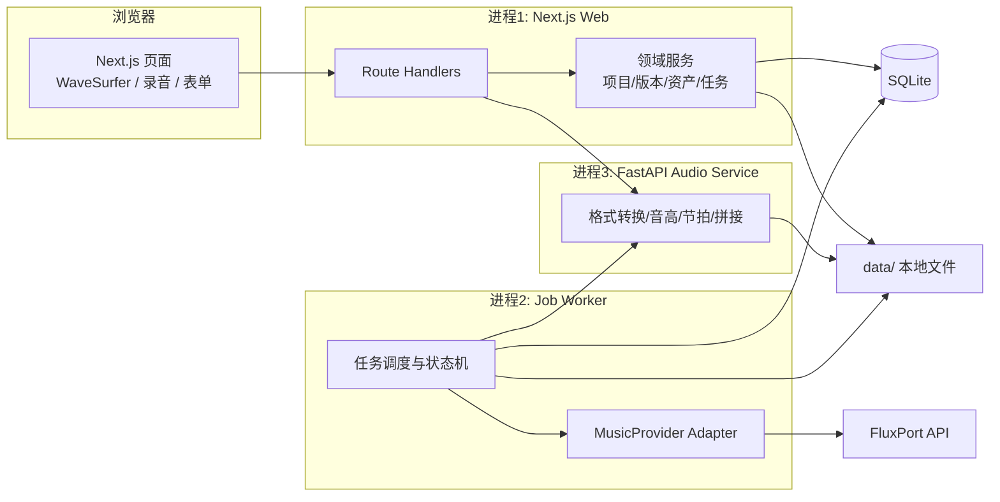
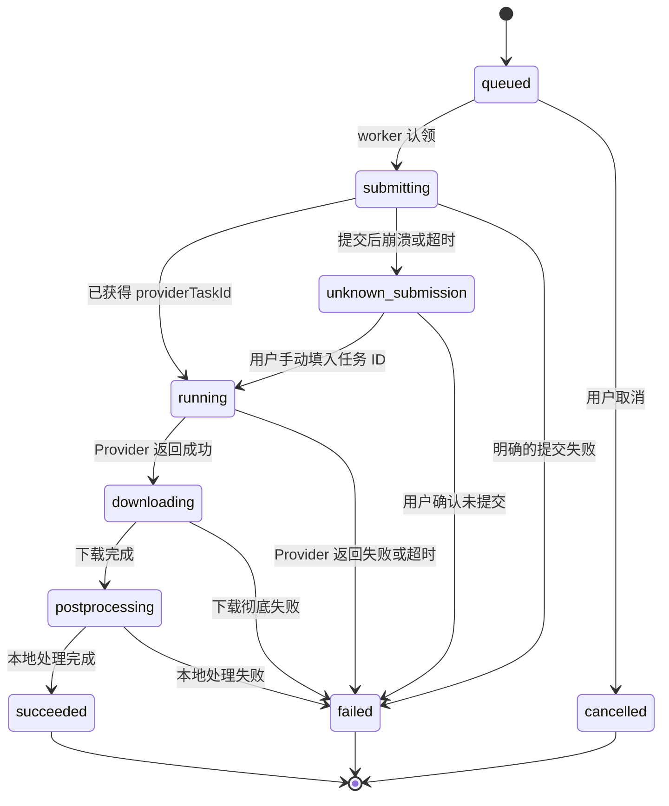
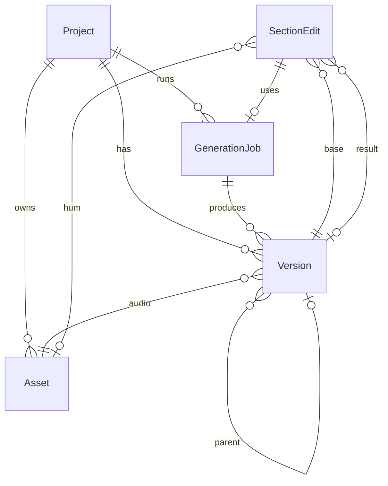
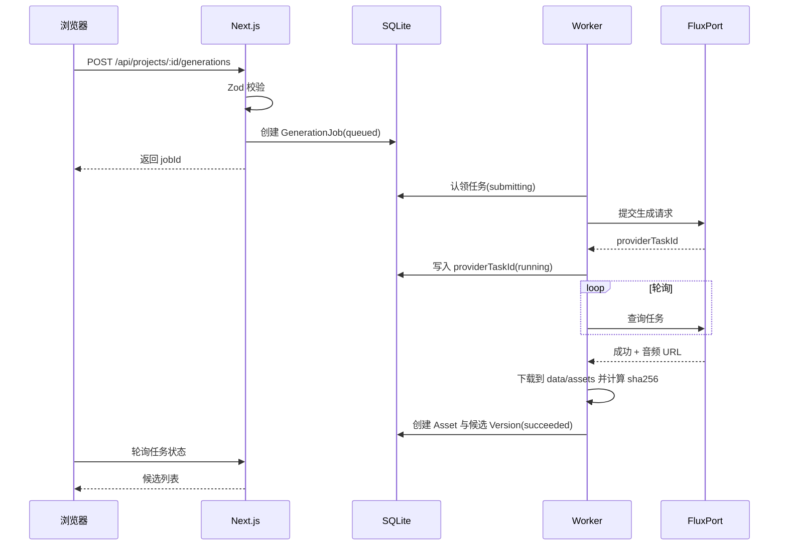

# AI Music Studio 技术架构

> 当前实现（2026-10-20）：`web/` 使用 Next.js 16 / React 19 / Prisma 7 + better-sqlite3 / SQLite WAL，独立 Node worker；已有 Python 服务继续保留。界面先使用原生控件、CSS 与真实峰值 SVG 波形，WaveSurfer、Tailwind/shadcn 随后续录音/编辑需求再引入。
>
> FluxPort 实测为**同步生成**，没有 Provider 任务 ID/轮询/回调。当前状态为 `queued → submitting → downloading → succeeded`；明确失败为 `failed`，提交中断为 `unknown_submission`，下载未完成为 `download_failed`。后者可只恢复下载。新增 suno-api.io 实验性适配：`queued → uploading → submitting → running → downloading → succeeded`。免费上传可重试，收费提交不自动重提；持久化歌曲 ID 后恢复查询，`poll_failed` 可手动继续查询，`unknown_submission` 需核对平台记录。下文通用 submit/poll 接口仍为扩展草案。
>
> 已落地实体：Project、GenerationJob、JobOutput、Version、WorkerState、HumAsset。HumAsset 同时记录原始/标准化音频路径与哈希、音高/BPM 分析和预处理参数。Version 内嵌音频路径、哈希、采样信息和峰值；本地编辑通过 `parentVersionId` 和 `paramsSnapshot` 记录素材、区间、淡化与实际处理参数。JobOutput 保存候选进度，成功后清除远端 URL；worker 通过单实例租约与心跳恢复任务，生成认领使用条件更新。原始文件只追加，输出不覆盖。
>
> 浏览器通过 MediaRecorder/Web Audio 录音与显示实时波形；文件经 Next.js 保存后，由本机 Python `/prepare` 转成标准 WAV 并做 YIN 差分音高与起音自相关速度估计。`/replace` 在 44.1 kHz 解码域做选区内线性淡化，输出浮点 WAV 保留选区外采样。浏览器只访问 Next.js，服务端再访问本机 Python；服务响应通过 Zod 校验。本地录音/编辑流程不向外部上传。用户提交 AI 实验任务时，Node worker 向 suno-api.io 上传所选音频，执行参考生成或文字条件段落重写。Key 存于服务器环境变量或权限为 0600 的设置文件，公开接口不返回密钥。JobOutput 额外记录歌曲 ID 与原始下载路径，用于查询和本地处理恢复。

> 文档版本：v0.1（第一阶段规划稿）
> 更新日期：2026-10-20
> 说明：顶部记录当前实现，下文保留整体架构与扩展草案。涉及外部 API 的部分以 [API_CAPABILITY_PLAN.md](./API_CAPABILITY_PLAN.md) 的验证结论为准。

## 1. 设计原则

1. **本地优先**：单机运行，所有数据和音频保存在本地磁盘，服务只监听 `127.0.0.1`。
2. **Provider 隔离**：音乐 API 的参数与响应结构只存在于 Provider Adapter 内部。
3. **能力驱动**：功能是否可用、采用哪种策略，由 Adapter 声明的能力决定，而不是写死在界面里。
4. **只追加不覆盖**：音频资产不可变，所有修改产生新资产和新版本。
5. **够用即可**：不引入消息队列、缓存集群、微服务，三个本地进程即可满足需求。

## 2. 技术栈评估

| 领域 | 初步建议 | 评估结论 | 说明与备选 |
| --- | --- | --- | --- |
| 前端框架 | Next.js App Router + React + TypeScript | 采用 | 页面与服务端接口在同一工程，适合单人维护。备选 Vite + React + Fastify，更轻但需要自己组织前后端，收益不明显 |
| 样式与组件 | Tailwind CSS + shadcn/ui | 采用 | 组件源码在本地，易于定制音频类控件 |
| 服务端接口 | Next.js Route Handlers | 采用，但**不在其中执行长任务** | Route Handler 只负责校验、写库、返回任务 ID；生成任务交给独立 worker 进程 |
| 数据库 | SQLite | 采用 | 单用户本地场景足够；开启 WAL 模式，支持 Web 进程与 worker 并发读写 |
| ORM | Prisma | 采用 | 迁移管理成熟。JSON 字段需确认所选 Prisma 版本对 SQLite `Json` 类型的支持，不支持则存为字符串并用 Zod 解析。备选 Drizzle + better-sqlite3（更轻、同步 API），可在骨架阶段再定 |
| 校验 | Zod | 采用 | 用于表单、接口入参、Provider 响应、Python 服务响应 |
| 波形 | WaveSurfer.js v7 | 采用 | 自带 Regions（区间选择）、Record（录音）、Timeline 插件，正好覆盖区间框选与录音需求；长音频使用预计算峰值数据 |
| 音频处理服务 | Python FastAPI + librosa + FFmpeg | 采用 | 音高提取、节拍检测、时间拉伸、拼接等在 Python 生态最成熟，Node 侧没有同等质量的库 |
| 音高提取 | librosa `pyin` | 首选 | 无需深度学习依赖。若对哼唱效果不理想，再评估 basic-pitch（可直接输出 MIDI）或 torchcrepe |
| 时间拉伸/变调 | pyrubberband（依赖 rubberband 命令行） | 按需引入 | 仅在局部替换需要校正速度或调性时使用 |
| 人声分离 | Demucs | 后期可选 | 依赖较重；只用于分轨替换或旋律遵循度评估 |
| 后台任务 | 独立 Node worker 进程 + SQLite 任务表 | 采用 | 不引入 Redis/BullMQ；任务通过原子更新"认领"，重启后可恢复 |
| 单元测试 | Vitest | 采用 | TypeScript 侧 |
| Python 测试 | pytest | **新增** | 音频处理逻辑需要独立测试 |
| 端到端测试 | Playwright | 采用 | 配合 `MockProvider`，不消耗真实额度 |
| 包管理 | pnpm | 建议 | 速度快、锁文件稳定；Python 侧建议 uv 管理虚拟环境 |

**系统依赖**：Node.js 20+、Python 3.11+、FFmpeg（需在 PATH 中）。可选：rubberband。

## 3. 进程与模块划分



- 浏览器只与 Next.js 通信，**不直接访问** FluxPort 或 Python 服务。
- Python 服务只监听 `127.0.0.1`，只被 Web 进程和 worker 调用。
- API Key 只在 worker 进程（以及必要时的 Web 服务端）读取。

### 3.1 建议目录结构

```text
Song/
├── docs/                      # 规划与验证文档
│   └── api-evidence/          # 能力验证证据（脱敏后的请求/响应样本）
├── web/                       # Next.js 应用 + worker
│   ├── src/app/               # 页面与 Route Handlers
│   ├── src/domain/            # 项目、版本、资产、任务等领域逻辑
│   ├── src/providers/         # MusicProvider 接口与各 Adapter
│   ├── src/worker/            # worker 入口与任务处理器
│   ├── src/lib/               # 日志脱敏、文件存储、配置
│   └── prisma/                # schema 与 migrations
├── audio-service/             # FastAPI 音频服务
│   ├── app/
│   └── tests/
├── scripts/                   # 能力验证脚本、备份脚本
├── data/                      # 运行时数据（gitignore）
│   ├── db/app.db
│   ├── assets/<projectId>/    # 音频资产，文件名为内容哈希
│   └── trash/
├── .env.example
└── .gitignore
```

## 4. Provider Adapter 设计

### 4.1 接口草案

以下为设计草案，具体字段会根据验证结论调整。

```ts
type CapabilityLevel = "verified" | "unverified" | "unsupported";

interface ProviderCapabilities {
  textToSong: CapabilityLevel;
  instrumental: CapabilityLevel;
  audioUpload: CapabilityLevel;
  audioUploadMode?: "multipart" | "base64" | "public_url";
  coverFromAudio: CapabilityLevel;          // 上传音频后按其旋律重新演绎
  extendFromAudio: CapabilityLevel;
  sectionReplace: CapabilityLevel;          // 模型原生的区间替换
  sectionReplaceAudioCondition: CapabilityLevel; // 区间替换是否接受音频条件
  stems: CapabilityLevel;
  wavExport: CapabilityLevel;
  limits: { minSectionSec?: number; maxUploadSec?: number; maxUploadBytes?: number };
}

interface MusicProvider {
  id: string;
  capabilities(): ProviderCapabilities;
  submit(request: GenerationRequest): Promise<{ providerTaskId: string }>;
  poll(providerTaskId: string): Promise<ProviderTaskStatus>;
  uploadAudio?(asset: LocalAudio): Promise<{ providerAudioRef: string }>;
}
```

- `GenerationRequest` 是项目内部的领域模型（如 `kind: "text" | "hum_cover" | "section_replace"`），由 Adapter 翻译为具体 API 参数。
- `capabilities()` 的取值来自验证记录，未验证的一律为 `unverified`，界面不开放对应功能。
- 计划中的实现：
  - `MockProvider`：返回本地示例音频，用于开发与测试。
  - `FluxPortSunoProvider`：在 C01-C04 验证通过后实现。
  - 预留其他 Provider（例如提供 `upload_cover` / `replace_section` 的其他 Suno 网关），由用户决定是否接入。

### 4.2 策略选择

对于哼唱成曲和局部替换，业务层根据能力选择策略，并把策略名和实现方式标签写入版本记录：

| 场景 | 条件 | 策略 | 标签 |
| --- | --- | --- | --- |
| 哼唱成曲 | `coverFromAudio = verified` 且 C07 判定遵循旋律 | Provider 上传 + cover | API 原生 |
| 哼唱成曲 | 上传可用，但原始哼唱遵循度差 | 本地转 MIDI 合成引导旋律，再 cover | API 原生 + 本地处理 |
| 哼唱成曲 | 不支持音频条件 | 不提供"按哼唱生成"，或接入备选 Provider | 降级方案 |
| 局部替换 | `sectionReplace` 与 `sectionReplaceAudioCondition` 均 verified | 原生区间替换 + 本地重建 | API 原生 + 本地处理 |
| 局部替换 | 只有 `sectionReplace` | 原生区间替换（文字条件）+ 本地重建，界面注明"未使用哼唱" | 降级方案 |
| 局部替换 | 只有 `coverFromAudio` | 用哼唱生成新片段，本地对齐并拼接 | 降级方案 |

详细路线对比见 [API_CAPABILITY_PLAN.md](./API_CAPABILITY_PLAN.md) 第 5、6 节。

## 5. 任务系统

### 5.1 状态机



### 5.2 可靠性要点

- **认领**：worker 用一条带条件的 `UPDATE ... WHERE status='queued'` 认领任务，避免重复处理。
- **幂等**：先把状态写为 `submitting` 再发请求；拿到 `providerTaskId` 后立即落库。崩溃恢复时，`submitting` 状态且无任务 ID 的任务进入 `unknown_submission`，**不自动重提**，避免重复扣费。
- **恢复**：worker 启动时扫描 `running` / `downloading` / `postprocessing` 状态的任务继续处理。
- **轮询**：间隔与超时取自 C04 验证结论，带指数退避。
- **并发**：同时运行的远程任务数可配置。

## 6. 数据实体

以下为逻辑模型，最终以 Prisma schema 为准。



| 实体 | 主要字段 |
| --- | --- |
| `Project` | `id`、`name`、`createdAt`、`updatedAt`、`archivedAt`、`selectedVersionId`、`lyricsDraft`、`promptDraft`（JSON） |
| `Asset` | `id`、`projectId`、`kind`（`hum` / `import` / `generated` / `segment` / `stem` / `derived`）、`path`、`sha256`、`format`、`sampleRate`、`channels`、`durationSec`、`sourceAssetId`（派生来源）、`createdAt` |
| `Version` | `id`、`projectId`、`parentVersionId`、`assetId`、`sourceType`（`import` / `text_generate` / `hum_generate` / `section_edit`）、`status`（`candidate` / `kept`）、`implementation`（`api_native` / `local` / `fallback`，可多值）、`strategy`、`provider`、`model`、`paramsSnapshot`（JSON，脱敏）、`lyricsSnapshot`、`promptSnapshot`、`jobId`、`label`、`createdAt` |
| `GenerationJob` | `id`、`projectId`、`kind`、`status`、`provider`、`model`、`requestParams`（JSON，脱敏）、`providerTaskId`、`attempts`、`errorCode`、`errorMessage`、`rawResponseExcerpt`（脱敏）、`costEstimate`、`submittedAt`、`finishedAt` |
| `SectionEdit` | `id`、`projectId`、`baseVersionId`、`startSec`、`endSec`、`humAssetId`、`instruction`、`strategy`、`crossfadeMs`、`jobId`、`resultVersionId`、`createdAt` |
| `CapabilityRecord` | `id`、`provider`、`capabilityKey`（对应 C01-C14）、`level`、`evidencePath`、`notes`、`verifiedAt` |

说明：

- "原始歌曲""候选歌曲""最终选定版本"都通过 `Version` 表达：导入的原曲为 `sourceType=import`，候选为 `status=candidate`，最终选定由 `Project.selectedVersionId` 指向。
- 每次生成时把歌词和提示词做快照存入版本，项目里的草稿可以继续修改而不影响历史。

## 7. 主要数据流

### 7.1 文字生成歌曲



### 7.2 局部替换（本地重建原则）

无论 Provider 返回整曲还是片段，最终版本都由本地重建：

```text
最终音频 = 原曲[0, start - fade]
         + 交叉淡化(原曲, 新内容, fade)
         + 新内容[start, end]
         + 交叉淡化(新内容, 原曲, fade)
         + 原曲[end + fade, 结尾]
```

这样即使模型对未选中区域有细微改动，最终版本的未修改区域仍与原曲逐样本一致（交叉淡化区域除外）。

### 7.3 音频文件访问

- 浏览器通过 `GET /api/assets/:id/stream` 播放音频，接口支持 HTTP Range 以便拖动进度。
- 波形峰值数据由音频服务预计算并缓存，避免长音频在浏览器端解码过慢。

## 8. 外部音频上传的问题

许多 Suno 类接口要求提供**公网可访问的音频 URL**，而本应用运行在本机，没有公网地址。可选方案：

| 方案 | 优点 | 缺点 |
| --- | --- | --- |
| Provider 提供文件上传接口（multipart / base64） | 最简单、隐私风险最低 | 取决于 C06 验证结果 |
| 临时隧道（如 cloudflared）暴露单个文件 | 无需额外存储服务 | 本机临时暴露到公网，需严格限时、限文件 |
| 对象存储预签名 URL（如 S3 / R2） | 链接可控、可过期 | 需要额外账号和配置，偏离"纯本地" |

推荐顺序：优先 Provider 上传接口；不支持时由用户显式选择后两种之一，并在界面提示隐私风险。

## 9. 安全设计

- **Key 存放**：`.env.local` 中的 `FLUXPORT_API_KEY`（变量名暂定），只在服务端读取；**禁止**使用 `NEXT_PUBLIC_` 前缀。
- **配置读取**：集中在服务端配置模块，用 Zod 校验，在客户端代码中 import 时构建报错（例如使用 `server-only` 包）。
- **日志脱敏**：统一 logger，脱敏请求头中的 `Authorization`、`x-api-key`、`x-goog-api-key`，以及 URL 中的签名参数。
- **仓库防护**：`.gitignore` 包含 `.env*`（保留 `.env.example`）、`data/`；构建后扫描产物，确认不含 Key。
- **网络暴露**：所有本地服务只绑定 `127.0.0.1`。
- **证据文件**：`docs/api-evidence/` 下的样本必须先脱敏再保存。

## 10. 后续可扩展点（不在第一阶段实现）

- 更多 Provider Adapter（通过 `MusicProvider` 接口接入）。
- 本地开源模型 Provider（如需要 GPU 的音乐模型），以同一接口接入。
- 版本树可视化、分轨编辑。
- 打包为桌面应用（如 Tauri / Electron）。
