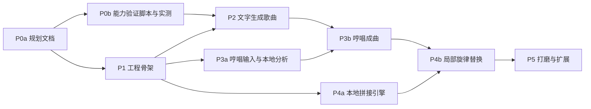

# AI Music Studio 实施路线图

> 当前进度（2026-10-20）：P1/P2 本地闭环已实现，FluxPort 同步协议已接入；P2 连续三次收费生成验收仍待执行。P3a 录音、上传、预处理、音高/BPM 核心功能已实现；P4a 已实现基础等长片段替换和 A/B 编辑界面，节拍对齐、调性校正、时间拉伸未实现。P3b/P4b 已接入 suno-api.io 并开放实验入口（独立 Key），模拟服务流程通过，真实效果与计费待验收。

本轮验证：TypeScript 检查、生产构建、11 项后端测试、19 项 Python 测试、6 条浏览器端到端流程通过。新增覆盖 5 个已知频率的音高误差 <50 音分、120 BPM 点击节奏、静音识别、WebM 录音转换、原音哈希、选区外逐样本相等、浮点 WAV 解码一致性、片段长度约束，以及虚拟麦克风的暂停/恢复/保存、权限拒绝和未保存录音离开保护。真实接口的网络稳定性、扣费、歌词演唱质量，以及真实人声分析效果仍需后续实测。

> 文档版本：v0.1（第一阶段规划稿）
> 更新日期：2026-10-20
> 说明：依赖外部能力的阶段，其最终范围以 [API_CAPABILITY_PLAN.md](./API_CAPABILITY_PLAN.md) 的验证结论为准。

## 1. 总体顺序

关键点：

- **P0b（能力验证）与 P1（骨架）可以并行**。骨架只依赖 `MockProvider`，不需要 Key。
- 不依赖外部 API 的部分（录音、音高分析、本地拼接引擎）提前做，验证结论出来后直接接入。
- 每个阶段结束都要有可运行、可演示的结果，并通过该阶段的验收标准后再进入下一阶段。

## 2. 阶段详情

### P0a 规划文档（当前阶段）

| 项目 | 内容 |
| --- | --- |
| 交付物 | `docs/` 下 5 份文档 |
| 依赖 | 无 |
| 验收 | 用户审阅确认需求边界、技术选型和实施顺序 |

### P0b 能力验证

| 项目 | 内容 |
| --- | --- |
| 交付物 | `scripts/` 下的验证脚本；`.env.example`；`.gitignore`；`docs/api-evidence/` 证据；更新后的 API_CAPABILITY_PLAN 结论表 |
| 依赖 | 用户在 `.env.local` 中配置 Key；付费调用前确认预算 |
| 工作内容 | 按 C01 到 C14 的顺序执行；C02 失败时暂停，与用户讨论备选 Provider |
| 验收 | 每项能力都有"支持 / 不支持 / 部分支持"的结论和证据；证据文件中不含 Key；明确哼唱成曲与局部替换各自采用的路线 |

### P1 工程骨架（不依赖外部 API）

| 项目 | 内容 |
| --- | --- |
| 交付物 | `web/` Next.js 工程（TypeScript 严格模式、Tailwind、shadcn/ui）；Prisma schema 与首个 migration；本地文件存储模块；`MockProvider`；worker 进程与任务状态机；`audio-service/` FastAPI 最小服务（健康检查、格式转换、波形峰值）；一键启动脚本 |
| 功能 | 项目新建、列表、重命名、归档；导入歌曲作为初始版本；波形播放（支持拖动）；版本列表与选定版本；用 `MockProvider` 跑通"提交任务 → 轮询 → 生成候选版本" |
| 依赖 | 无 |
| 验收 | 无网络、无 Key 时可完成完整的 Mock 生成流程；worker 重启后未完成任务能恢复；导入文件 sha256 不变；构建产物扫描不含 Key 字样的环境变量值；Vitest、pytest、Playwright 冒烟测试通过 |

### P2 文字生成歌曲

| 项目 | 内容 |
| --- | --- |
| 交付物 | 真实 Provider Adapter（FluxPort 或用户选定的备选）；生成表单；候选对比页 |
| 功能 | 歌词、主题、风格、情绪、演唱方式、乐器、自由描述输入；提交与进度展示；结果自动下载到本地；多候选试听对比；重新生成；失败原因展示；费用提示（若 C14 有数据） |
| 依赖 | P1；C01-C05 通过 |
| 验收 | 连续 3 次真实生成全部成功落盘并可离线播放；断网或 Provider 报错时任务正确标记失败并显示原因；重试不产生重复提交；版本记录中参数、模型、歌词快照完整 |

### P3a 哼唱输入与本地分析（不依赖外部 API）

| 项目 | 内容 |
| --- | --- |
| 交付物 | 浏览器录音组件（WaveSurfer Record 插件）；上传组件；音频服务的预处理、音高提取、BPM 估计接口 |
| 功能 | 录音、重录、回放；上传任意常见格式并转换为标准 WAV；裁剪首尾静音与响度归一化；音高曲线与 BPM 显示；可选转 MIDI 并合成引导旋律试听 |
| 依赖 | P1 |
| 验收 | Chrome 录音（webm）能正确转换；对已知音高的合成测试音，音高提取误差在 50 音分以内；原始哼唱文件保留不变 |

### P3b 哼唱成曲

| 项目 | 内容 |
| --- | --- |
| 交付物 | 哼唱成曲流程页；对应的生成策略 |
| 功能 | 选择哼唱（原始或引导旋律）+ 歌词 + 风格，提交生成；原哼唱与结果对照试听；版本上标注实现方式 |
| 依赖 | P2、P3a；C06、C07 结论 |
| 分支 | C07 通过：按路线 A（或 A + C）实现；C07 不通过：本阶段只交付"不可用说明 + 备选 Provider 评估报告"，不交付冒充功能 |
| 验收 | 使用 C07 的同一套测试素材，结果达到 C07 的判定标准；界面标签与实际实现一致 |

### P4a 本地拼接引擎（不依赖外部 API）

| 项目 | 内容 |
| --- | --- |
| 交付物 | 音频服务中的裁剪、节拍检测、速度与调性检测、对齐、交叉淡化、重建接口；对应的 pytest |
| 功能 | 输入原曲、区间和新内容，输出按"本地重建原则"生成的完整音频 |
| 依赖 | P1 |
| 验收 | 空测试：区间外样本与原曲完全一致（交叉淡化区域除外）；衔接处无削波；用同一首歌的两个片段做替换时，节拍偏差小于 20 毫秒 |

### P4b 局部旋律替换

| 项目 | 内容 |
| --- | --- |
| 交付物 | 编辑页：波形区间选择（Regions 插件，支持吸附节拍和数值微调）、哼唱录制、修改要求输入、策略提示、A/B 对比、另存版本 |
| 功能 | 按 API_CAPABILITY_PLAN 第 7 节的推荐，根据能力选择策略；提交前展示策略和限制；结果 A/B 对比（整曲、仅区间、衔接处）；确认后保存为新版本 |
| 依赖 | P3b、P4a；C09-C11 结论 |
| 验收 | 原版本文件哈希不变；新版本的 `SectionEdit` 记录完整；区间外空测试通过；界面策略标签与实际实现一致；在至少 3 首测试歌曲上人工试听衔接评分达到"可接受" |

### P5 打磨与扩展

候选内容（按用户反馈排序后再定）：

- 版本树可视化。
- 导出与一键备份/恢复。
- 分轨（C12 或本地 Demucs）与"只替换人声"路线。
- 带时间戳歌词驱动的区间选择（C13）。
- 旋律遵循度指标在界面中展示。
- 更多 Provider、本地开源模型评估。

## 3. 测试策略

| 层级 | 工具 | 覆盖内容 |
| --- | --- | --- |
| TypeScript 单元测试 | Vitest | Zod schema；任务状态机转换；Provider Adapter 的请求构造与响应解析（使用 C 系列验证中录制的脱敏样本）；日志脱敏器；版本与资产的不可变规则 |
| Python 单元测试 | pytest | 格式转换；音高提取（用合成正弦波，已知频率）；节拍检测（用已知 BPM 的节拍器音频）；拼接空测试；交叉淡化无削波 |
| 集成测试 | Vitest + 本地 SQLite | Route Handler 到数据库；worker 认领、恢复、重试；`unknown_submission` 场景不自动重提 |
| 端到端测试 | Playwright + `MockProvider` | 新建项目 → 生成 → 试听 → 选定版本；录音/上传哼唱；区间选择 → 编辑 → A/B → 另存版本 |
| 真实 API 冒烟 | 手动触发的脚本 | 每次升级 Adapter 后跑一次最小生成；不纳入自动化，避免产生费用 |
| 安全检查 | 脚本 | 构建产物与日志中搜索 Key 值；确认 `.env.local`、`data/` 未被 Git 跟踪 |
| 听感评估 | 人工评分表 | 哼唱遵循度（1-5 分）、衔接自然度（1-5 分）、整体可用性；记录在证据目录 |

### 3.1 哼唱遵循度的客观参考指标

1. 用 pYIN 提取哼唱和生成结果的音高曲线（有分轨时用人声轨）。
2. 转换为半音，并减去各自的中位数，消除调性差异。
3. 用 DTW 对齐后计算平均距离。
4. 与对照组（不提供哼唱的生成结果）比较。

该指标只作参考，不能代替试听，界面展示时需注明计算方式。

### 3.2 拼接空测试

1. 以原曲为输入，"新内容"直接使用原曲同一区间。
2. 执行重建后，与原曲逐样本相减。
3. 期望结果：使用线性（等增益）交叉淡化时整首残差为 0。等功率曲线在两段信号相同时会使交叉淡化区间幅度升高（最多约 3 dB），因此空测试固定使用线性曲线，等功率曲线只用于不同内容的实际拼接。
4. 再用不同内容替换，检查区间外残差为 0、衔接点峰值不超过 0 dBFS。

## 4. 推荐的近期执行顺序

1. 用户审阅本批文档并确认。
2. 用户在 `.env.local` 中配置 FluxPort Key（不要把 Key 粘贴到聊天里）。
3. 并行进行：
   - P0b：先执行 C01、C02（几乎不产生费用），确认是否存在 Suno 接口。
   - P1：初始化 Git 仓库与工程骨架。
4. 根据 C02 结论决定：继续用 FluxPort 推进 C03-C14，或评估备选 Provider。
5. 依次推进 P2、P3a/P4a（可并行）、P3b、P4b。

## 5. 决策记录

| 日期 | 决策 | 依据 |
| --- | --- | --- |
| 2026-10-20 | FluxPort 只支持文字生成；默认模型选 `suno`（实测可达约 5 分钟，一次 2 首），`Lyria-3.5音频音乐` 作为备选 | API_CAPABILITY_PLAN C02-C15 |
| 2026-10-20 | 哼唱成曲与局部替换暂缓；先完成基于 FluxPort 的文字创作应用（P1 + P2） | 用户决定；备选路线见 `docs/research/SUNO_GATEWAY_COMPARISON.md`（首推 suno-api.io）与 `docs/research/LOCAL_MODEL_FEASIBILITY.md`（ACE-Step 1.5 / YuE2） |
| 2026-10-20 | P2 下载策略：同一次生成的多首结果并行下载、显示进度，下载失败只重试下载、绝不重新生成 | C15 实测 Suno 单首下载约 9 分钟，链接有效期约 1 小时 |

## 6. 每阶段完成时的汇报内容

- 完成的功能与未完成的部分。
- 验收标准逐项结果。
- 新发现的能力限制或风险。
- 对后续阶段范围的调整建议。

| 2026-10-20 | 用户要求全部开放：新增 suno-api.io 实验性参考生成、文字条件段落重写、服务 Key 配置和异步查询恢复；真实效果待验收 | 18 项后端测试、8 条浏览器流程及生产构建通过；测试未调用外部收费接口 |
