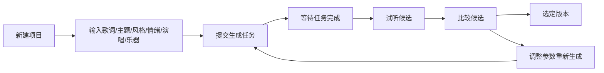
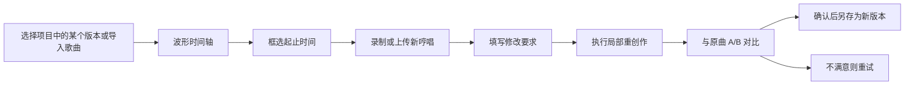

# AI Music Studio 项目概览

> 文档版本：v0.2
> 更新日期：2026-10-20
> 状态：文字创作本地闭环、哼唱录音/分析、本地等长片段替换已实现。真实 Provider 连续调用验收待完成；AI 哼唱成曲和 AI 段落重写已接入 suno-api.io 并开放实验入口，通过模拟流程测试，真实效果尚未验收。

## 1. 项目背景

AI Music Studio 是一个运行在本地电脑上的 Web 应用，定位为个人使用的 AI 音乐创作工作台。

它不是单页的"输入提示词、生成一首歌"工具，而是一个以**歌曲项目**为中心的创作环境：管理歌曲项目、调用 AI 生成音乐、根据用户哼唱创作旋律、修改已有歌曲的局部片段，并完整保留每一次创作的版本历史。

文字生成通过 **FluxPort**（`https://uselg.top`，一个 AI 模型 API 中转网关）的同步 Chat 接口调用 Suno / Lyria。此前已完成能力实测；FluxPort 无音频输入和局部替换能力，详见 [API_CAPABILITY_PLAN.md](./API_CAPABILITY_PLAN.md) 第 11 节。

### 1.1 当前工程现状（2026-10-20 核实）

| 项目 | 现状 |
| --- | --- |
| 代码 | `web/` Next.js 应用与独立 Node worker；`audio-service/` FastAPI 音频服务 |
| 项目文档 | 需求、架构、能力验证、路线图、模型调研与根目录 README |
| `package.json` / 依赖 | `web/package.json` 与 npm 锁文件 |
| 环境变量示例 | 根目录 `.env.example`；已有 `.env.local` 只供服务端读取 |
| 已集成的音乐 API | FluxPort 同步文字生成；suno-api.io 实验性参考生成与段落重写；演示模式不访问外部 |
| Git 仓库 | 已初始化，尚未提交 |
| 本地闭环 | 项目/草稿/归档恢复、队列、候选版本、波形/试听、导入/下载、选定与参数复用 |

启动方法见根目录 [README](../README.md)。当前默认演示模式，不会自动产生真实生成费用。完整产品目标仍按下文描述逐步推进；涉及哼唱和局部替换的内容属于后续规划。

## 2. 产品定位

- **用户**：单人、本地使用，具备基本音乐审美但不一定会编曲或使用 DAW 的创作者。
- **运行方式**：在本机启动 Web 服务，浏览器访问 `localhost`。数据和音频文件保存在本地磁盘。
- **核心价值**：
  1. 用自然语言、歌词和哼唱快速得到可试听的完整歌曲。
  2. 对已有歌曲做"只改这一段"的局部修改。
  3. 所有尝试都留痕，可随时回退、对比、选定。

## 3. 核心用户流程

### 3.1 流程一：文字创作歌曲

### 3.2 流程二：哼唱旋律创作完整歌曲

关键要求：生成结果应尽量保留哼唱的音高走势、节奏和乐句结构。**只有当所用模型确实以哼唱音频作为生成条件时，才能把结果称为"按哼唱生成"。**

### 3.3 流程三：替换现有歌曲的局部旋律

关键要求：只改选定区域，其他区域尽可能保持不变，并与原曲自然衔接。**若无法严格实现，必须在界面上说明实际采用的降级方式。**

### 3.4 贯穿全流程：项目与版本管理

- 每首歌是一个独立项目。
- 每次生成、每次局部修改都产生新版本，**不覆盖**任何已有音频。
- 可浏览版本历史、试听任一版本、设为"当前选定版本"。

## 4. 核心功能

| 模块 | 功能 | 依赖的外部能力 |
| --- | --- | --- |
| 项目管理 | 新建、重命名、归档项目；保存歌词与提示词 | 无 |
| 文字创作 | 按歌词与描述生成歌曲，多候选对比，重新生成 | 待验证：文字生成歌曲 |
| 哼唱输入 | 浏览器录音、上传音频、格式规范化、音高曲线预览 | 无（本地处理） |
| 哼唱成曲 | 以哼唱为条件生成完整歌曲 | 待验证：音频上传 + 音频条件生成 |
| 局部替换 | 波形框选区间、哼唱条件重创作、拼接与对比 | 待验证：局部替换 / 音频条件；本地拼接引擎 |
| 版本管理 | 版本历史、候选、选定版本、参数与模型记录 | 无 |
| 任务管理 | 异步任务、状态跟踪、失败重试、错误记录 | 无（本地实现） |

## 5. 能力真实性原则

这是本项目最重要的产品原则，优先级高于"功能看起来完整"。

1. **不编造能力**：Provider 未经实测验证的能力，不在代码或界面上宣称支持。
2. **如实标注实现方式**：每个生成结果都记录并在界面上显示其实现方式，分为三类：
   - `API 原生`：由音乐模型直接完成，例如模型原生的局部替换。
   - `本地处理`：由本地音频服务完成，例如裁剪、拼接、交叉淡化。
   - `降级方案`：目标能力不可用时采用的替代方式，并说明与目标效果的差距。
3. **禁止冒充**：不能把"纯文字提示生成的歌曲"标注为"按哼唱生成"；不能把"整首重新生成"标注为"局部替换"。
4. **能力随验证结论更新**：Provider Adapter 通过 `capabilities()` 声明能力，界面据此启用或禁用功能。

## 6. 非目标（第一阶段明确不做）

- 多租户 SaaS、用户注册、账号与权限体系。
- 社交社区、作品分享、评论。
- 多人在线协作。
- 云端存储与同步。
- 微服务集群、消息队列中间件（如 Redis、Kafka）。
- 专业 DAW 级别的多轨编辑、混音和母带处理。
- 移动端适配。

架构保持模块化，以便未来扩展，但不为上述非目标预先实现代码。

## 7. 优先级

1. 功能真实可用。
2. 音乐创作体验。
3. 音频处理质量。
4. 任务可靠性。
5. 数据安全。
6. 易于维护和迭代。

## 8. 相关文档

- [REQUIREMENTS.md](./REQUIREMENTS.md)：功能与非功能需求、验收标准、异常场景。
- [ARCHITECTURE.md](./ARCHITECTURE.md)：技术架构、模块划分、数据流与数据实体。
- [API_CAPABILITY_PLAN.md](./API_CAPABILITY_PLAN.md)：音乐模型能力验证清单与备选方案。
- [IMPLEMENTATION_ROADMAP.md](./IMPLEMENTATION_ROADMAP.md)：分阶段开发计划与验收标准。
